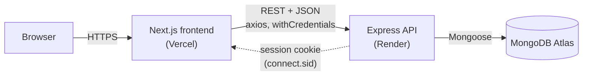
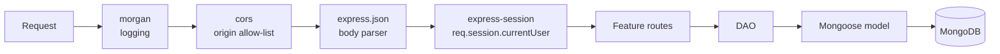
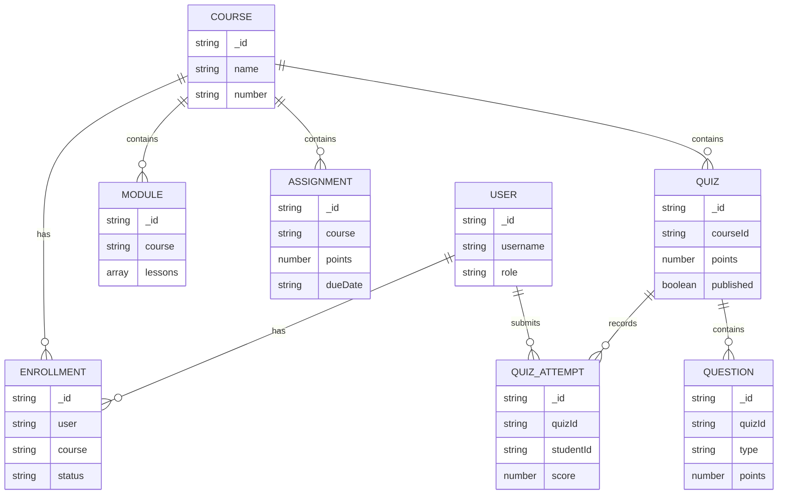

# Kambaz Node Server

The REST API for **Kambaz**, a Canvas-style learning management system. It's built with Express 5 and MongoDB (Mongoose). The frontend that uses it is [kambaz-next-js-quiz](https://github.com/kashyap03042003/kambaz-next-js-quiz).

- **Deployed API:** https://kambaz-node-server-app-quiz-7l9y.onrender.com
- **Deployed frontend:** https://kambaz-next-js-quiz.vercel.app

## Features

- Users: sign up, sign in and sign out with sessions (`express-session`), plus a profile.
- Roles: `ADMIN`, `FACULTY`, `TA`, `STUDENT` and `USER`.
- Courses, modules, assignments and enrollments.
- Quizzes: questions, attempts and scores.

## Tech stack

Node.js · Express 5 · MongoDB Atlas · Mongoose · express-session · cors · morgan

## High-level architecture



The system has three tiers:

1. **Frontend** ([kambaz-next-js-quiz](https://github.com/kashyap03042003/kambaz-next-js-quiz)). A Next.js app on Vercel that renders the UI and keeps client state in Redux. It calls this API over HTTPS.
2. **API (this repo).** A stateless Express server on Render that handles authentication, authorization data and all CRUD operations.
3. **Database.** MongoDB Atlas holds one collection per feature.

### Request pipeline

Every request goes through the same middleware chain in [index.js](index.js) before it reaches a feature's routes:



| Layer | File | Job |
|---|---|---|
| Routes | `routes.js` | HTTP handling: reads params, body and session, and sends the JSON response or a 500 error |
| DAO | `dao.js` | Data access functions such as `findCoursesForUser` and `createQuiz` |
| Model | `model.js` | Mongoose model bound to a collection |
| Schema | `schema.js` | Document shape, enums and `ref`s |

### Authentication and sessions

- `POST /api/users/signin` checks the username and password, then stores the user in `req.session.currentUser`.
- The browser holds a session cookie. In production it's `secure`, `sameSite=none` and `httpOnly`, because the frontend and API are on different domains. That's also why CORS uses `credentials: true` and an exact origin allow-list.
- Later requests such as `/api/users/profile` read the current user from the session. Sessions are kept in memory (MemoryStore), so they're lost whenever the server restarts.
- The API checks roles in only a few places. An `ADMIN` gets every course from `/api/users/:uid/courses`, and a `STUDENT` sees only published quizzes. Edit permissions (faculty can edit, students can only view) are enforced in the frontend only.

### Data model



All IDs are strings: UUIDs, or readable IDs such as `RS101` in the seed data. Relationships are stored as ID fields, not embedded documents, except for module lessons. An enrollment's ID is `<userId>-<courseId>`.

## Getting started

### 1. Install

```bash
npm install
```

### 2. Configure environment

Create a `.env` file in the project root:

```env
SERVER_ENV=development
CLIENT_URL=http://localhost:3000
SERVER_URL=http://localhost:4000
SESSION_SECRET=<any random string>
DATABASE_CONNECTION_STRING=mongodb+srv://<user>:<password>@<cluster>.mongodb.net/?appName=<AppName>
```

| Variable | Purpose |
|---|---|
| `SERVER_ENV` | `development` uses lax, non-secure cookies. Any other value uses `secure` + `sameSite=none` cookies, which a cross-site deployment needs. |
| `CLIENT_URL` | The frontend's URL. It's allowed by CORS, so it must match exactly, with no trailing slash. |
| `CLIENT_URL_2` | Optional. A second allowed origin, such as a Vercel preview URL. |
| `SESSION_SECRET` | Signs the session cookies. |
| `DATABASE_CONNECTION_STRING` | MongoDB connection string. |

`http://localhost:3000` is always allowed by CORS.

### 3. Run

```bash
npm start      # node index.js
npm run dev    # nodemon index.js (needs: npm i -D nodemon)
```

The server listens on **port 4000**, or on `PORT` if it's set. It exits if it can't connect to MongoDB.

## Project structure

```
index.js              App setup: MongoDB, CORS, sessions, routes
Hello.js              GET /hello health check
Lab5/                 Course lab exercises
Kambaz/
  Users/              schema · model · dao · routes
  Courses/
  Modules/
  Assignments/
  Enrollments/
  Quizzes/
  Questions/
  QuizAttempts/
  Database/           Seed data (courses, modules, assignments, ...)
```

Each feature folder follows the same pattern: `schema.js` → `model.js` → `dao.js` → `routes.js`.

## API overview

| Area | Endpoints |
|---|---|
| Auth | `POST /api/users/signup` · `signin` · `signout` · `profile` |
| Users | `GET /api/users` · `GET/PUT /api/users/:userId` · `POST /api/users` |
| User courses | `GET /api/users/:uid/courses` · `POST /api/users/:uid/courses/:cid` · `POST /api/users/current/courses` |
| Courses | `GET/POST /api/courses` · `PUT/DELETE /api/courses/:courseId` · `GET /api/courses/:courseId/users` |
| Modules | `GET/POST /api/courses/:courseId/modules` · `PUT/DELETE /api/modules/:moduleId` |
| Assignments | `GET/POST /api/courses/:courseId/assignments` · `GET/PUT/DELETE /api/assignments/:assignmentId` |
| Enrollments | `POST /api/enrollments` · `GET /api/enrollments/course/:courseId` · `GET /api/users/:userId/enrollments` · `DELETE /api/enrollments/user/:userId/course/:courseId` |
| Quizzes | `GET /api/quizzes/course/:courseId` · `GET /api/quizzes/:quizId` · questions and attempts under `/api/quizzes/:quizId/...` |

## Deploying to Render

1. Create a **Web Service** from this repo. Build command: `npm install`. Start command: `npm start`.
2. Set these environment variables in Render: `DATABASE_CONNECTION_STRING`, `CLIENT_URL` (your Vercel URL), `SESSION_SECRET`, and `SERVER_ENV=production`.
3. In MongoDB Atlas, go to **Network Access** and allow `0.0.0.0/0`, because Render has no fixed outbound IP.

On the free plan, the service sleeps when it's idle. The first request after that can take about a minute.
